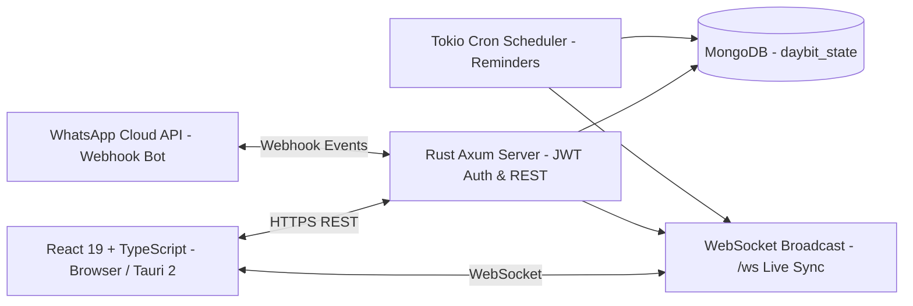

<div align="center">

<br />


# Daybit

### Minimalist. Real-Time. Cross-Platform Task Workspace.

**Daybit** is a full-stack task manager and productivity suite crafted with **React 19 + TypeScript**, a high-speed **Rust (Axum)** backend, **MongoDB** persistence, **WebSocket** live synchronization, and **Tauri 2** native builds for **Windows**, **Linux**, and **Android**.

<p>
  
  
  
  
  
  <a href="releases/v0.2/"></a>
</p>

<p>
  <a href="#-why-daybit">About</a> •
  <a href="#-feature-highlights">Features</a> •
  <a href="#%EF%B8%8F-architecture">Architecture</a> •
  <a href="releases/v0.2/"><strong>Release v0.2</strong></a> •
  <a href="#-getting-started">Quick Start</a> •
  <a href="#-api--websocket">API</a> •
  <a href="#-multi-os-builds">Builds</a>
</p>

</div>

---

## ⚡ Why Daybit?

Designed around a monochrome **frosted-glass aesthetic** (`#000000` / `#ffffff`) with smooth linear animations and zero-latency interactions, **Daybit** brings your daily planning, analytics, focus timers, and messaging alerts together in one unified workspace:

- **One Codebase, Everywhere:** Run natively on desktop & mobile via **Tauri 2** or in any modern browser.
- **Instant Sync Across Devices:** Drag a card or check off a task on one device and see every connected session update live over **WebSockets**.
- **Built-In Focus & Utility Suite:** Never leave your flow for a **Calculator**, **Countdown Timer / Stopwatch**, **Calendar**, or **WhatsApp Task Bot**.
- **Deep Personalization:** Switch view layouts, background color circles, global typography, and full **multi-language** UI translations *(including English, Tamil, Telugu, and Hindi)*.

---

## ✨ Feature Highlights

<table>
  <tr>
    <td width="50%" valign="top">
      <h3>📋 Unified Task Workflows</h3>
      <ul>
        <li><strong>Kanban, Board &amp; List Views:</strong> Drag-and-drop cards across <em>To Do</em>, <em>In Progress</em>, <em>Review</em>, and <em>Complete</em> with <code>@dnd-kit</code>.</li>
        <li><strong>0ms Optimistic Checkboxes:</strong> Instant completion toggle and segmented progress bars (<code>done / total</code>).</li>
        <li><strong>Place &amp; Live Search:</strong> Filter by <strong>College</strong>, <strong>Work</strong>, or <strong>Personal</strong> and jump directly to tasks from the live search dropdown.</li>
        <li><strong>Invites &amp; Collaboration:</strong> Share tasks with teammates via email invites.</li>
      </ul>
    </td>
    <td width="50%" valign="top">
      <h3>📊 Dashboard &amp; Scheduling</h3>
      <ul>
        <li><strong>Live Analytics:</strong> Track Active, Overdue, Completed, and Unscheduled tasks alongside completion rate % and weekly trend charts.</li>
        <li><strong>Horizontal Date Strip &amp; Calendar:</strong> Scroll horizontally through upcoming deadlines on the Dashboard or inspect full-month schedules in Calendar view.</li>
        <li><strong>Cron Reminder Engine:</strong> Background <code>tokio-cron-scheduler</code> triggers alerts with <strong>Accept</strong>, <strong>Remind (+15m)</strong>, and <strong>Reject</strong> actions.</li>
        <li><strong>Web Audio Ringtones:</strong> 5 synthesized custom tones (<code>chime</code>, <code>digital-bell</code>, <code>marimba</code>, <code>pulse</code>, <code>gentle-gong</code>).</li>
      </ul>
    </td>
  </tr>
  <tr>
    <td width="50%" valign="top">
      <h3>🛠️ Built-In Productivity Tools</h3>
      <ul>
        <li><strong>Timer &amp; Stopwatch:</strong> Presets (<code>5m</code>, <code>15m</code>, <code>25m</code>, <code>45m</code>), custom <code>+</code> timer, bold red <code>00.0</code> finish state, and lap tracking.</li>
        <li><strong>Keyboard-Ready Calculator:</strong> Click or type seamlessly using your physical keyboard &amp; numpad.</li>
        <li><strong>WhatsApp Cloud API Bot:</strong> Manage tasks straight from WhatsApp using <code>add</code>, <code>list today</code>, and <code>done &lt;id&gt;</code> — toggleable directly from Settings.</li>
      </ul>
    </td>
    <td width="50%" valign="top">
      <h3>🎨 Customization &amp; i18n</h3>
      <ul>
        <li><strong>Theme Color Circles:</strong> Custom dark &amp; light background palettes (Pure Obsidian, Deep Carbon, Slate Midnight, Mint Fresh, Ice Blue, etc.).</li>
        <li><strong>9 Global Font Families:</strong> Inter, Roboto, Outfit, Plus Jakarta Sans, JetBrains Mono, Poppins, Noto Sans Tamil, Noto Sans Telugu, Noto Sans Devanagari.</li>
        <li><strong>8 Languages:</strong> Instant translation across English, <strong>தமிழ் (Tamil)</strong>, <strong>తెలుగు (Telugu)</strong>, <strong>हिन्दी (Hindi)</strong>, Spanish, French, German, and Japanese.</li>
      </ul>
    </td>
  </tr>
</table>

---

## 🏗️ Architecture



---

## 🛠️ Tech Stack

| Layer | Technologies |
| :--- | :--- |
| **Frontend** | React 19, TypeScript, Vite 8, Tailwind CSS, Lucide Icons, `@dnd-kit/core`, `@dnd-kit/sortable` |
| **Backend** | Rust, Axum 0.7, Tokio, Argon2 Password Hashing, HS256 JWT (Access & Refresh) |
| **Scheduler** | `tokio-cron-scheduler` |
| **Database** | MongoDB (`mongodb` 2.8) + SQL reference schema (`backend/migrations/20261110000000_init.sql`) |
| **Desktop & Mobile** | Tauri 2 (`src-tauri`) targeting Windows, Linux, and Android |
| **Integrations** | Meta WhatsApp Cloud API, Web Audio API, Browser Desktop Notifications |

---

## 📦 Release v0.2

The v0.2 Windows desktop app bundles its frontend, saves tasks locally, and does not start separate frontend or backend servers. Build instructions and the installer script are in [`releases/v0.2/`](releases/v0.2/README.md). Release binaries are generated by the Windows build script and are not checked into this source tree.

---

### Prerequisites
- **Rust & Cargo** (stable)
- **Node.js 18+** & **npm**
- **MongoDB** (Local `mongodb://localhost:27017/daybit` or MongoDB Atlas)

### 1. Clone the Repository
```bash
git clone https://github.com/Sudhan-2603/Daybit.git
cd Daybit
```

### 2. Configure Environment Variables
Create `backend/.env` using `.env.example`:
```env
PORT=4000
DATABASE_URL=mongodb+srv://<username>:<db_password>@<cluster>.mongodb.net/daybit?retryWrites=true&w=majority
JWT_SECRET=replace_with_a_long_random_secret

# Optional: WhatsApp Cloud API Integration
WHATSAPP_ACCESS_TOKEN=your_whatsapp_cloud_api_access_token_here
WHATSAPP_PHONE_NUMBER_ID=your_whatsapp_phone_number_id_here
WHATSAPP_VERIFY_TOKEN=daybit_whatsapp_verify_token
```

### 3. Start Backend & Frontend
```bash
# Terminal 1 — Rust API Server (http://localhost:4000)
cd backend
cargo run

# Terminal 2 — React + Vite Client (http://localhost:5173)
cd frontend
npm install
npm run dev
```

> **Windows Quick Launch:** Install Daybit and open it from the Desktop shortcut or Start Menu. The desktop app bundles its frontend and saves tasks locally; it does not start separate frontend or backend servers.

### Deploy the API backend to Render

The root [`render.yaml`](render.yaml) defines only a Rust web service; it does not create a Render database. MongoDB Atlas is the backend's only database. In Render, create a Blueprint from this repository and provide `DATABASE_URL` using your Atlas connection string when prompted. JWT authentication stays enabled, and Render generates `JWT_SECRET`; it supplies the service `PORT` automatically. The service health check uses `/health`.

After Render creates the service, use its `https://<service>.onrender.com` URL as `VITE_API_URL` for web frontend builds. Set `VITE_WS_URL` to `wss://<service>.onrender.com/ws` for live sync. The local desktop v0.2 build continues to use local storage and does not call this backend.

### Deploy the frontend to GitHub Pages

The [`deploy-frontend.yml`](.github/workflows/deploy-frontend.yml) workflow builds the Vite app and publishes it to GitHub Pages on every push to `main`. The expected site URL is `https://sudhan-2603.github.io/Daybit/`. In repository Settings → Pages, choose **GitHub Actions** as the publishing source. If the Render backend is deployed, add repository variables `VITE_API_URL` and `VITE_WS_URL`; without them, the Pages frontend starts in local-storage mode.

---

## 🔌 API & WebSocket

<details>
<summary><strong>Click to expand all REST &amp; WebSocket endpoints</strong></summary>

<br />

| Method | Endpoint | Purpose |
| :--- | :--- | :--- |
| `POST` | `/auth/register` | Register a new account (Argon2 password hashing) |
| `POST` | `/auth/login` | Sign in and obtain JWT access &amp; refresh tokens |
| `POST` | `/auth/refresh` | Refresh an expired access token |
| `GET` | `/auth/me` | Fetch the current authenticated user |
| `GET` / `POST` | `/tasks` | List all user tasks or create a new task |
| `PUT` / `DELETE` | `/tasks/:id` | Update task status/details or remove a task |
| `POST` | `/tasks/:id/respond` | Respond to a reminder (`accept`, `remind`, `reject`) |
| `POST` | `/tasks/:id/invite` | Invite a collaborator to a task |
| `GET` | `/invites` | Retrieve task invitations |
| `POST` | `/devices` | Register a device push token |
| `GET` | `/dashboard` | Fetch completion stats, status counts &amp; place metrics |
| `GET` | `/ws` | Live WebSocket stream for multi-device sync |
| `GET` / `POST` | `/whatsapp/webhook` | Meta WhatsApp webhook verification &amp; bot commands |

</details>

---

## 📂 Project Structure

<details>
<summary><strong>Click to view full workspace layout</strong></summary>

<br />

```text
Daybit/
├── Cargo.toml                         # Cargo workspace (backend + src-tauri)
├── .env.example                       # Environment variable template
├── Daybit.bat                         # Opens the installed standalone desktop app
├── backend/                           # Rust Axum API, scheduler & MongoDB store
│   ├── Cargo.toml
│   ├── migrations/20261110000000_init.sql
│   └── src/
│       ├── main.rs                    # Router, CORS & server entry
│       ├── config.rs                  # Environment config loader
│       ├── auth.rs                    # Argon2 & HS256 JWT helpers
│       ├── db.rs                      # MongoDB persistence layer
│       ├── scheduler.rs               # Tokio reminder cron worker
│       └── routes/                    # auth, tasks, dashboard, ws, whatsapp
├── frontend/                          # React + TypeScript + Tailwind app
│   ├── index.html
│   ├── package.json
│   ├── public/daybit-logo.png
│   └── src/
│       ├── App.tsx                    # Workspace shell, themes, fonts & state
│       ├── services/                  # api.ts, websocket.ts, audio.ts, i18n.ts
│       └── components/                # Navbar, TabBar, Kanban, Views & Modals
└── src-tauri/                         # Tauri 2 native wrapper (Win, Linux, Android)
    ├── Cargo.toml
    ├── tauri.conf.json
    └── src/
```

</details>

---

## 📦 Multi-OS Cross-Platform Applications

Daybit packages are available for **Windows**, **Ubuntu**, **Arch Linux**, and **Android Mobile (APK)**. Full documentation is available in **[releases/CROSS_PLATFORM_APPS.md](releases/CROSS_PLATFORM_APPS.md)**.

| Platform | Format | Operating System Target | Command / Installation |
| :--- | :--- | :--- | :--- |
| **Windows** | `.exe` / `.msi` | Windows 10 & 11 (x64) | Run `Daybit-Setup.exe` or `Daybit-Setup.msi` |
| **Ubuntu / Debian** | `.deb` | Ubuntu 20.04+, Debian, Mint | `sudo dpkg -i daybit_0.2.0_amd64.deb` |
| **Arch Linux** | `.AppImage` | Arch Linux, Manjaro, EndeavourOS, Fedora | `chmod +x Daybit-0.2.0.AppImage && ./Daybit-0.2.0.AppImage` |
| **Mobile Android** | `.apk` | Android 7.0 - 14+ | Tap `Daybit-v0.2.0.apk` on your phone to install |

### Automated Cloud Builds via GitHub Actions
Every release is automatically compiled across Windows, Ubuntu, Arch Linux, and Android runners via [`.github/workflows/build-all-platforms.yml`](.github/workflows/build-all-platforms.yml). Download the latest builds directly from the **[Actions Tab Artifacts](https://github.com/Sudhan-2603/Daybit/actions)**.

---

<div align="center">
  <sub>Built with Rust, React 19, TypeScript, Tauri 2 &amp; Capacitor</sub>
</div>
